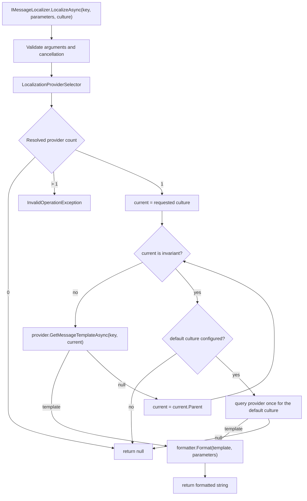

<div dir="rtl">

# 4. النموذج الذهني (mental model)

يصف هذا الفصل نموذج وقت التشغيل بالترتيب الذي يحدث فيه البحث (lookup) فعلاً. إذا فهمت هذا الفصل،
فمعظم ما بعده تكوين (configuration) وسير عمل.

## دورة حياة البحث (lookup lifecycle)

يمرّ نداء <code dir="ltr">IMessageLocalizer.LocalizeAsync</code> بالمراحل التالية:

1. **التحقق من الوسائط.** تجري فحوص القيم الفارغة أولاً؛ ويستبدل التحميل المريح
   (convenience overload) الثقافة بـ <code dir="ltr">CultureInfo.CurrentUICulture</code>.
2. **فحص الإلغاء (cancellation).** رمز إلغاء ملغى مسبقاً يرمي قبل أي عمل للمزوّد.
3. **اختيار المزوّد (provider).** يحمل المُعرِّب <code dir="ltr">IMessageProvider</code>، وعادةً
   يكون <code dir="ltr">LocalizationProviderSelector</code>، الذي يفوّض إلى
   <code dir="ltr">IInnerMessageProvider</code> الوحيد، أو يعيد <code dir="ltr">null</code> عند
   غياب أي مزوّد، أو يرمي عند حلّ أكثر من واحد.
4. **الحل بالارتداد (fallback).** استعلم عن الثقافة المطلوبة، ثم كل أب (parent)، ثم الثقافة
   الافتراضية (default culture) الاختيارية؛ وتوقف عند أول قالب غير فارغ.
5. **معالجة الغياب.** إذا غاب كل شيء، أبلغ مستقبل المفاتيح المفقودة (missing-key sink)
   الاختياري وأعد <code dir="ltr">null</code>.
6. **التنسيق (formatting).** إذا حُلّ قالب، فمرّره مع وسائط المستدعي إلى المنسّق (formatter)
   المضبوط.
7. **إكمال التشخيص (diagnostics).** يكتمل النشاط والمدة وعدّادات الإصابة والغياب عند وجود
   مستمعين.

لا توجد خطوة تلتقط استثناء المزوّد وتحوّله إلى غياب. أعطال قواعد البيانات والملفات المشوهة
والإلغاء وأخطاء المنسّق تنتشر. الغياب يعني أن "كل بحث مطابق تماماً أعاد
<code dir="ltr">null</code>"، لا أن "شيئاً ما فشل".

## مزوّد واحد بالضبط

ينفّذ <code dir="ltr">LocalizationProviderSelector</code> الواجهة
<code dir="ltr">IMessageProvider</code>، ويسجّله <code dir="ltr">AddLocalization</code>. يستقبل
المُنشئ نسخ <code dir="ltr">IInnerMessageProvider</code> المحلولة، ويفرض القاعدة المعمارية:

- **صفر مزوّدين** مسموح. كل بحث يعيد <code dir="ltr">null</code>. هذا مفيد في الاختبارات، أو في
  مضيف يفعّل التعريب شرطياً.
- **مزوّد واحد** هو الحالة الطبيعية. يفوّض المحدّد كل نداء إليه.
- **أكثر من مزوّد** غير صالح. يرمي الإنشاء <code dir="ltr">InvalidOperationException</code>
  ويسمّي أنواع المزوّدين المحلولة.

لا ترتيب ولا أولوية ولا دمج ولا ارتداد على مستوى المزوّد. لا يفحص المحدّد واصفات DI (Dependency Injection) بنفسه؛ نسخ
المزوّدين المحلولة هي المجموعة المرجعية.

النتيجة سهلة القول وسهلة النسيان: إذا وجب أن يساهم مصدران في رسائل تطبيق واحد، فيجب دمجهما قبل
التسجيل. صدّر مصدراً داخل الآخر، أوولّد كتالوجاً مدموجاً وقت البناء، أو اجعل أحد المصدرين مرجعياً.
إضافة مزوّد ثانٍ لا تنشئ سلسلة.

## خوارزمية الارتداد

يملك <code dir="ltr">DefaultMessageLocalizer</code> التنفيذ الوحيد لارتداد الثقافة (culture
fallback). شبه الكود:

<div dir="ltr">

```text
current = requested culture
while current is not null and current is not InvariantCulture:
    if provider.GetMessageTemplateAsync(key, current) returns a template:
        return that template
    current = current.Parent

if a default culture is configured:
    return provider.GetMessageTemplateAsync(key, defaultCulture)

return null
```

</div>

ثلاثة تفاصيل مهمة:

- **الثقافة الثابتة (invariant culture) لا تُستعلم أبداً.** هي الأب الطرفي للثقافات المحايدة،
  لكنها ليست لغة ولا كتالوجاً. تتوقف الحلقة قبل الاستعلام عنها.
- **الثقافة الافتراضية تُستعلم مرة واحدة بعد مشي الآباء.** ليست جزءاً من سلسلة الآباء. وإذا كانت
  الثقافة الافتراضية أباً للثقافة المطلوبة أيضاً، فقد تكون استُعلمت سابقاً؛ ومع ذلك تنفّذ
  الخوارزمية الاستعلام الأخير عن الثقافة الافتراضية عند الغياب. هذا الاستعلام المكرر غير ضار ويظهر
  في مقاييس خطوات الارتداد.
- **المزوّد يبقى مطابقاً تماماً (exact-match).** كل خطوة تطلب مفتاحاً واحداً وثقافة واحدة.
  المُعرِّب هو المكوّن الوحيد الذي ينتقل بين الثقافات.

تُلتقط الثقافة الافتراضية عند إنشاء <code dir="ltr">DefaultMessageLocalizer</code>. وتعديل كائن
<code dir="ltr">LocalizationOptions</code> بعد ذلك لا يغيّر مُعرِّباً موجوداً. في DI يكون
المُعرِّب singleton، لذا تكون الثقافة الافتراضية ثابتة فعلياً طوال عمر العملية. عطّل خطوة الثقافة
الافتراضية بضبط <code dir="ltr">DefaultCulture</code> كنص فارغ؛ يتعامل المُعرِّب مع
<code dir="ltr">null</code> أو النص الفارغ كـ "لا ثقافة افتراضية".

### أمثلة محلولة

الثقافة المطلوبة <code dir="ltr">de-CH</code>، والمفتاح <code dir="ltr">Cart.Items</code>،
والافتراضية <code dir="ltr">en</code>. يحمل المزوّد <code dir="ltr">de</code> و
<code dir="ltr">en</code>: يغيب <code dir="ltr">de-CH</code>، ويصيب <code dir="ltr">de</code>،
ويتوقف المشي قبل الافتراضية. يُنسّق القالب الألماني بالثقافة المطلوبة
<code dir="ltr">de-CH</code>، لذلك يتبع عرض الجمع والأرقام والتواريخ الثقافة المطلوبة، لا الثقافة
التي قدّمت القالب.

الثقافة المطلوبة <code dir="ltr">fr-CA</code>، والمفتاح نفسه، ولا إدخال لـ
<code dir="ltr">fr-CA</code> أو <code dir="ltr">fr</code> أو <code dir="ltr">en</code>: يغيب
<code dir="ltr">fr-CA</code>، ويغيب <code dir="ltr">fr</code>، وتُتخطى الثابتة، ويغيب
<code dir="ltr">en</code>، فتكون النتيجة <code dir="ltr">null</code>. لا يعيد المُعرِّب المفتاح
ولا نصاً فارغاً ولا علامة بين قوسين.

إذا مرّر المستدعي <code dir="ltr">CultureInfo.InvariantCulture</code>، تُتخطى حلقة الآباء وتكون
الثقافة الافتراضية هي المرشح الوحيد. كما تختصر مزوّدات الترجمة الثقافة الثابتة إلى
<code dir="ltr">null</code> دون استدعاء شبكي.

## مجموعات الموارد ليست رسائل

المفهوم الثاني في النطاق هو مخزن مجموعات الموارد (resource-set store). شكله مختلف عمداً.

| الجانب | خط أنابيب الرسائل (message pipeline) | مخزن مجموعات الموارد (resource-set store) |
|---|---|---|
| نقطة الدخول | <code dir="ltr">IMessageLocalizer</code> | <code dir="ltr">ILocalizationStore</code> |
| الهوية | مفتاح وثقافة | اسم مجموعة موارد، وثقافة، ومفتاح |
| الارتداد | المطلوبة، والآباء، والافتراضية | لا شيء؛ تُستخدم المجموعة والثقافة المطلوبتان بدقة |
| نتيجة الغياب | <code dir="ltr">null</code> من المُعرِّب | <code dir="ltr">LocalizedStringEntry</code> مع <code dir="ltr">ResourceNotFound = true</code> |
| التنسيق | <code dir="ltr">IMessageFormatter</code> قابل للضبط | فهارس <code dir="ltr">IStringLocalizer</code> تستخدم تنسيق الإطار المركّب |
| التغيير | لا يوجد؛ المزوّدون للقراءة فقط | CRUD (Create, Read, Update, Delete) مع مسار إدارة محكوم |

يربط <code dir="ltr">CustomStringLocalizerFactory</code> اسم نوع المورد
<code dir="ltr">Type.Name</code> (أو اسماً أساسياً صريحاً) باسم مجموعة موارد. يلتقط كل مُعرِّب
ثقافة الواجهة الحالية عند الإنشاء، ويعيد فحص المخزن في كل بحث، فلا يصبح غياب مؤقت دائماً. لا يمشي
الجسر (bridge) في ثقافات الآباء؛ و<code dir="ltr">GetAllStrings(true)</code> يعدّد الثقافة
المطلوبة الدقيقة فقط. تظهر الإدخالات الغائبة كـ <code dir="ltr">[MISSING:key]</code> مع
<code dir="ltr">ResourceNotFound = true</code>.

تقرأ الطبقتان مصادر مختلفة: مزوّد الرسائل لا يغذّي <code dir="ltr">IStringLocalizer</code>،
والمخزن لا يغذّي <code dir="ltr">IMessageLocalizer</code>. وإذا استُخدم المساران، فحافظ على
توافق كتالوجيهما عمداً.

## المفاتيح ودورة حياتها

المفتاح (key) نص معتم يختاره التطبيق. لا يستخرجه الإطار من الكود المصدري ولا من اسم نوع أو مساحة
أسماء، ولا يقصّه ولا يوحّد حالته ولا يفسّر النقاط كتسلسل هرمي. تشتق أدوات المفاتيح المولّدة
معرّفات C# من المفاتيح، لكن مفتاح وقت التشغيل يبقى النص الأصلي.

يُؤلَّف المفتاح بقالب افتراضي، ويُكتب في كتالوج مزوّد (كائن JSON أو عنصر XML أو إدخال ResX أو
<code dir="ltr">msgid</code> في PO (Portable Object) أو صف قاعدة بيانات)، ثم يتحول اختيارياً إلى ثابت مولّد،
ويُترجم، ويُبحث عنه وقت التشغيل، ثم يُعاد تسميته أو يُحذف في النهاية. يمكن للمخزن المحكوم أن يعيد
التسمية عبر الثقافات ذرياً؛ أما مزوّدو الملفات فيتطلبون تغيير محتوى وإعادة نشر.

المفاتيح نصوص دقيقة عند حدود المزوّد. يقارنها مزوّدو القواميس ترتيبياً وبحساسية لحالة الأحرف.
ويمرّر مزوّدو قواعد البيانات المفتاح كمعامل، لكن ترتيب قاعدة البيانات (collation) يحدد حساسية حالة
الأحرف؛ اضبط ترتيب العمود إن كان ذلك مهماً. يشترط المخزن المحكوم مفتاحاً غير فارغ، ويسمح بقيمة قالب
فارغة مع رفض <code dir="ltr">null</code>.

شكلان للمفاتيح يهمّان. يبني <code dir="ltr">LocalizeWithContextAsync</code> المفتاح
<code dir="ltr">context + '\u0004' + key</code> (فاصل EOT (End of Transmission) في gettext)؛ والسياق الفارغ يتصرف
كالمفتاح العادي. ويأخذ <code dir="ltr">LocalizePluralAsync</code> مفتاحاً مفرداً ومفتاحاً جمعاً؛
تختار <code dir="ltr">One</code> المفرد، وتختار كل فئة أخرى الجمع، ويجرّب غياب المفتاح المفضّل
المفتاح الآخر قبل سلسلة الثقافة. لا يُحقن العدد في الوسائط أبداً، لذا تحتاج القوالب التي تعرض
<code dir="ltr">{count}</code> إلى أن يوفّره المستدعي.

## أين يقع التنسيق

لا يعمل التنسيق إلا بعد حلّ قالب. الغياب يعيد <code dir="ltr">null</code> ولا يستدعي المنسّق
أبداً، فلا يمكن لرسالة غائبة أن تكتسب شكلاً منسّقاً.

يستبدل المنسّق الافتراضي العناصر النائبة المسماة <code dir="ltr">{...}</code>. الوسيط الغائب يبقى
كما هو؛ والقيمة <code dir="ltr">null</code> تصبح فارغة. المنسّق لا يراعي الثقافة: تستدعي القيم
<code dir="ltr">ToString()</code> وتستخدم <code dir="ltr">CurrentCulture</code> المحيطة. وعندما
ينفّذ المنسّق <code dir="ltr">ICultureAwareMessageFormatter</code>، مثل
<code dir="ltr">IcuMessageFormatter</code>، يمرّر المُعرِّب الثقافة المطلوبة بدلاً من ذلك.

جسر المخزن منفصل: يستخدم <code dir="ltr">IStringLocalizer</code> مع الوسائط
<code dir="ltr">string.Format(CultureInfo.CurrentCulture, ...)</code>. العناصر النائبة المسماة
ليست عقد التنسيق في مسار المخزن.

## دلالات الإلغاء (cancellation)

الإلغاء ليس رسالة غائبة. تأخذ الطرق القانونية <code dir="ltr">CancellationToken</code>
اختيارياً في النهاية بعد وسائطها المطلوبة. يُفحص الرمز بعد التحقق من الوسائط، ويُمرّر إلى كل نداء
مزوّد، ويُلاحظ قبل كل خطوة ارتداد وقبل التنسيق، ويُسمح له بالظهور كـ
<code dir="ltr">OperationCanceledException</code>.

لا يلتقط المُعرِّب <code dir="ltr">OperationCanceledException</code> أبداً ويحوّله إلى
<code dir="ltr">null</code>. إلغاء الطلب والإغلاق والمهلات تتصرف كإلغاء، لا كترجمات غائبة. تضيف
مزوّدات الترجمة قواعد إعادة محاولة ومهلة؛ ولا يُعاد محاولة إلغاء المستدعي. راجع
[الترجمة الآلية](../../en/02-guides/12-machine-translation.md).

## خط الأنابيب في نظرة واحدة

<div dir="ltr">



</div>

## مآزق وحدود

**مأزق:** تسجيل مزوّدين "لدمج" المصادر. الحلّ يرمي. وحّد المصادر أو اختر نظام تسجيل واحداً.

**مأزق:** توقّع أن مزوّد ملفات أحادي الثقافة يختار الثقافات. يملك
<code dir="ltr">JsonMessageProvider</code> المبني من ملف واحد خريطة مسطحة واحدة ويتجاهل وسيطة
الثقافة. أما التسجيل متعدد الثقافات فيغلّف مزوّداً لكل ثقافة في
<code dir="ltr">CultureAwareMessageProvider</code>؛ يوزّع هذا الغلاف باسم الثقافة الدقيق ثم باسم
اللغة المكوّن من حرفين، لكنه ليس سلسلة ارتداد.

**مأزق:** افتراض أن الارتداد يثبت التغطية. إصابة الثقافة الافتراضية الناجحة تبقى غياباً في الثقافة
المطلوبة. استخدم التكافؤ والتعريب الزائف للعثور على الفجوات.

**مأزق:** افتراض أن المخزن وخط الأنابيب يتشاركان البيانات. لا يتشاركانها. اختر المسار الذي يستخدمه
كل مستهلك، وحافظ على اتساق الكتالوجات عمداً.

**حد:** يوجد منسّق واحد للتطبيق. لا يمكن لعائلات رسائل مختلفة اختيار منسّقات مختلفة لكل بحث. ركّب
المنسّقات داخل تنفيذ واحد إن احتجت سلوكاً مختلطاً.

**حد:** تُثبَّت الثقافة الافتراضية عند إنشاء المُعرِّب. إعادة التكوين وقت التشغيل تتطلب استبدال
الخيارات والمُعرِّب، وهذا ليس مساراً سريعاً مدعوماً. تعامل مع تكوين الثقافة كتكوين بدء تشغيل.

</div>
