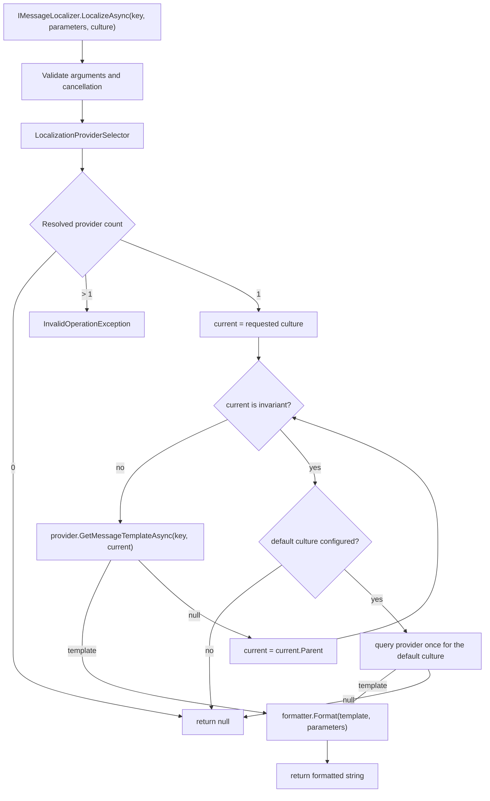

# 4. The Mental Model

This chapter describes the runtime model in the order a lookup actually happens. If you understand
this chapter, most of the rest of the book is configuration and workflow.

## The lookup lifecycle

A call to `IMessageLocalizer.LocalizeAsync` goes through these stages:

1. **Validate arguments.** Null checks run first; the convenience overload substitutes
   `CultureInfo.CurrentUICulture`.
2. **Check cancellation.** An already-cancelled token throws before any provider work.
3. **Select the provider.** The localizer holds `IMessageProvider`, normally
   `LocalizationProviderSelector`, which delegates to the one `IInnerMessageProvider`, returns
   `null` when none is registered, or throws when more than one was resolved.
4. **Resolve with fallback.** Query the requested culture, then each parent, then the optional
   default culture; stop at the first non-null template.
5. **Handle the miss.** If everything misses, report to the optional missing-key sink and return
   `null`.
6. **Format.** If a template resolved, pass it and the caller's parameters to the configured
   formatter.
7. **Complete diagnostics.** Activity, duration, and hit/miss counters complete when listeners are
   present.

No step catches a provider exception and turns it into a miss. Database failures, malformed files,
cancellation, and formatter errors propagate. A miss means "every exact-match lookup returned
null", not "something went wrong".

## Exactly one provider

`LocalizationProviderSelector` implements `IMessageProvider` and is registered by
`AddLocalization`. Its constructor receives the resolved `IInnerMessageProvider` instances and
enforces the architectural rule:

- **Zero providers** is allowed. Every lookup returns `null`. This is useful in tests or in a host
  that conditionally enables localization.
- **One provider** is the normal case. The selector delegates every call to it.
- **More than one provider** is invalid. Construction throws `InvalidOperationException` naming the
  resolved provider types.

There is no ordering, no priority, no merging, and no provider-level fallback. The selector does
not scan DI (Dependency Injection) descriptors itself; the resolved provider instances are the authoritative set.

The consequence is easy to state and easy to forget: if two sources must contribute messages to
one application, they must be combined before registration. Export one source into the other,
generate a merged catalog at build time, or make one source authoritative. Adding a second provider
does not create a chain.

## The fallback algorithm

`DefaultMessageLocalizer` owns the only culture-fallback implementation. In pseudocode:

```text
current = requested culture
while current is not null and current is not InvariantCulture:
    if provider.GetMessageTemplateAsync(key, current) returns a template:
        return that template
    current = current.Parent

if a default culture is configured:
    return provider.GetMessageTemplateAsync(key, defaultCulture)

return null
```

Three details matter:

- **The invariant culture is never queried.** It is the terminal parent of neutral cultures, but it
  is not a language and not a catalog. The loop exits before querying it.
- **The default culture is queried once, after the parent walk.** It is not part of the parent
  chain. If the default culture is also a parent of the requested culture, it may have been queried
  already; the algorithm still performs the final default-culture query on a miss. That duplicate
  query is harmless and visible in fallback-step metrics.
- **The provider remains exact-match.** Every step asks for one key and one culture. The localizer
  is the only component that moves between cultures.

The default culture is captured when `DefaultMessageLocalizer` is constructed. Mutating the
`LocalizationOptions` object afterwards does not change an existing localizer. In DI the localizer
is a singleton, so the default culture is effectively fixed for the process lifetime. Disable the
default-culture step by configuring `DefaultCulture` as an empty string; the localizer treats null
or empty as "no default culture".

### Worked examples

Requested `de-CH`, key `Cart.Items`, default `en`. The provider has `de` and `en`:
`de-CH` misses, `de` hits, and the walk stops before the default. The German template is formatted
with the requested `de-CH`, so culture-aware plural, number, and date rendering follow the requested
culture rather than the culture that supplied the template.

Requested `fr-CA`, same key, no `fr-CA`, `fr`, or `en` entry: `fr-CA` misses, `fr` misses,
invariant is skipped, `en` misses, and the result is `null`. The localizer never returns the key, an
empty string, or a bracketed marker.

If the caller passes `CultureInfo.InvariantCulture`, the parent loop is skipped and the default
culture is the only candidate. Translation providers also short-circuit invariant to `null` without
a network call.

## Resource sets are not messages

The second domain concept is the resource-set store. Its shape is intentionally different.

| Aspect | Message pipeline | Resource-set store |
|---|---|---|
| Entry point | `IMessageLocalizer` | `ILocalizationStore` |
| Identity | Key plus culture | Resource-set name, culture, and key |
| Fallback | Requested, parents, default culture | None; the requested set and culture are used exactly |
| Missing result | `null` from the localizer | A `LocalizedStringEntry` with `ResourceNotFound = true` |
| Formatting | Configurable `IMessageFormatter` | `IStringLocalizer` indexers use framework composite formatting |
| Mutation | None; providers are read-only | CRUD (Create, Read, Update, Delete) plus the governed administration path |

`CustomStringLocalizerFactory` maps a resource type's `Type.Name` (or an explicit base name) to a
resource-set name. Each localizer captures the current UI culture at creation and re-probes the
store on every lookup, so a temporary miss is never permanent. The bridge does not walk parent
cultures; `GetAllStrings(true)` enumerates only the captured exact culture. Missing entries surface
as `[MISSING:key]` with `ResourceNotFound = true`.

The layers read different sources: a message provider does not feed `IStringLocalizer`, and a store
does not feed `IMessageLocalizer`. If both paths are used, keep their catalogs aligned deliberately.

## Keys and their lifecycle

A key is an opaque string chosen by the application. The framework does not derive it from source
code, a class name, or a namespace. It does not trim it, normalize its case, or interpret dots as
hierarchy. The generated-keys tooling derives C# identifiers from keys, but the runtime key is
still the original string.

A key is authored with a default template, written into a provider catalog (JSON object, XML
element, ResX entry, PO (Portable Object) `msgid`, or database row), optionally turned into a generated constant,
translated, looked up at runtime, and eventually renamed or deleted. A governed store can rename
across cultures atomically; file providers require a content change and redeploy.

Keys are exact strings at the provider boundary. Dictionary-backed providers compare them
ordinally and case-sensitively. Database providers pass the key as a parameter, but the database
collation decides case sensitivity; configure the column collation if that matters. The governed
store requires a non-whitespace key and permits an empty template value while rejecting null.

Two key shapes matter. `LocalizeWithContextAsync` builds `context + '\u0004' + key` (the gettext
EOT (End of Transmission) separator); an empty context behaves like the plain key. `LocalizePluralAsync` takes a singular
and a plural key; `One` selects the singular, every other category selects the plural, and a
preferred-key miss tries the other key before the culture chain. The count is never injected into
the parameters, so templates rendering `{count}` need the caller to supply it.

## Where formatting fits

Formatting runs only after a template resolves. A miss returns `null` and never calls the
formatter, so a missing message cannot acquire a formatted shape.

The default formatter substitutes named `{...}` placeholders. A missing parameter stays literal; a
null value becomes empty. It is culture-unaware: values call `ToString()` and use the ambient
`CurrentCulture`. When the formatter implements `ICultureAwareMessageFormatter`, such as
`IcuMessageFormatter`, the localizer passes the requested culture instead.

The store bridge is separate: `IStringLocalizer` with arguments uses
`string.Format(CultureInfo.CurrentCulture, ...)`. Named placeholders are not the store path's
formatting contract.

## Cancellation semantics

Cancellation is not a missing message. The canonical methods take an optional final
`CancellationToken` after their required arguments. The token is checked after argument validation,
forwarded to every provider call, observed before each fallback step and before formatting, and
allowed to surface as `OperationCanceledException`.

The localizer never catches `OperationCanceledException` and converts it to `null`. Request
cancellation, shutdown, and timeouts behave like cancellation instead of absent translations.
Translation providers add retry and timeout rules; a caller's cancellation is never retried. See
[Machine translation](../02-guides/12-machine-translation.md).

## The pipeline at a glance



## Pitfalls and limits

**Pitfall:** registering two providers to "combine" sources. Resolution throws. Consolidate the
sources or choose one system of record.

**Pitfall:** expecting a single-culture file provider to select cultures. A `JsonMessageProvider`
built from one file owns one flat map and ignores the culture argument. Multi-culture registration
wraps one provider per culture in `CultureAwareMessageProvider`; that wrapper dispatches by exact
culture name and then two-letter language name, but it is not a fallback chain.

**Pitfall:** assuming fallback proves coverage. A successful default-culture hit is still a miss for
the requested culture. Use parity and pseudo-localization to find the gaps.

**Pitfall:** assuming the store and the pipeline share data. They do not. Pick the path each
consumer uses, and keep the catalogs consistent deliberately.

**Limit:** there is exactly one formatter for the application. Different message families cannot
choose different formatters per lookup. Compose formatters inside one implementation if you need
mixed behavior.

**Limit:** the default culture is fixed when the localizer is constructed. Runtime reconfiguration
requires replacing the options and the localizer, which is not a supported hot path. Treat culture
configuration as startup configuration.
